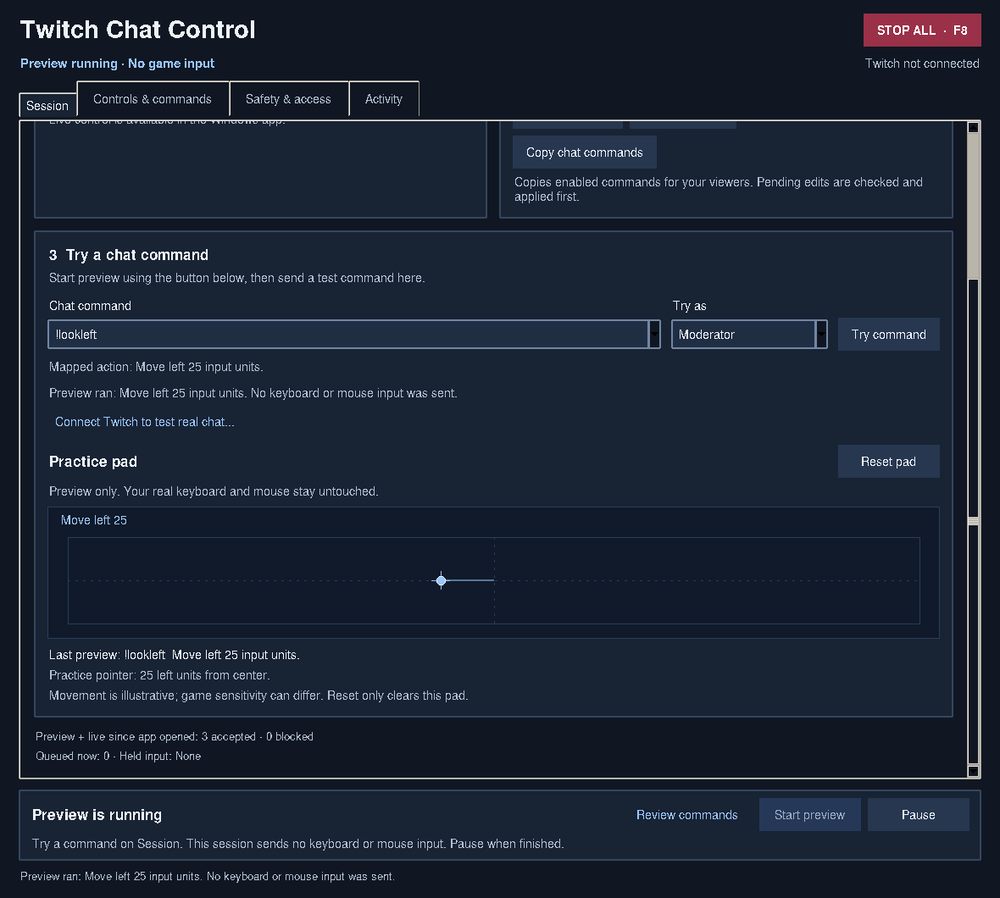
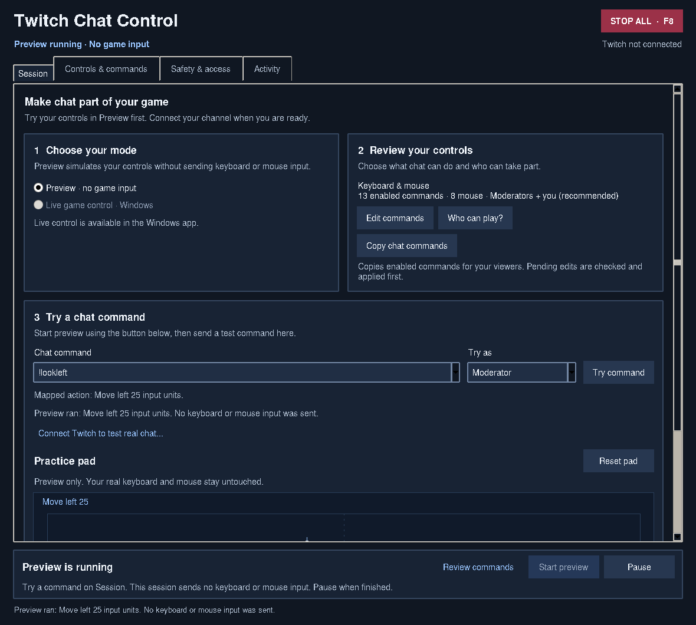
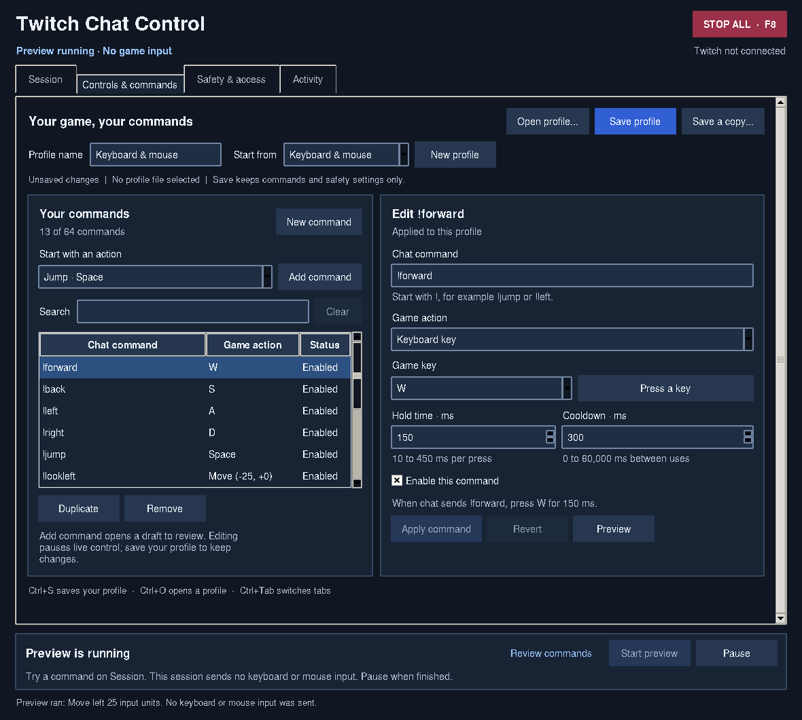
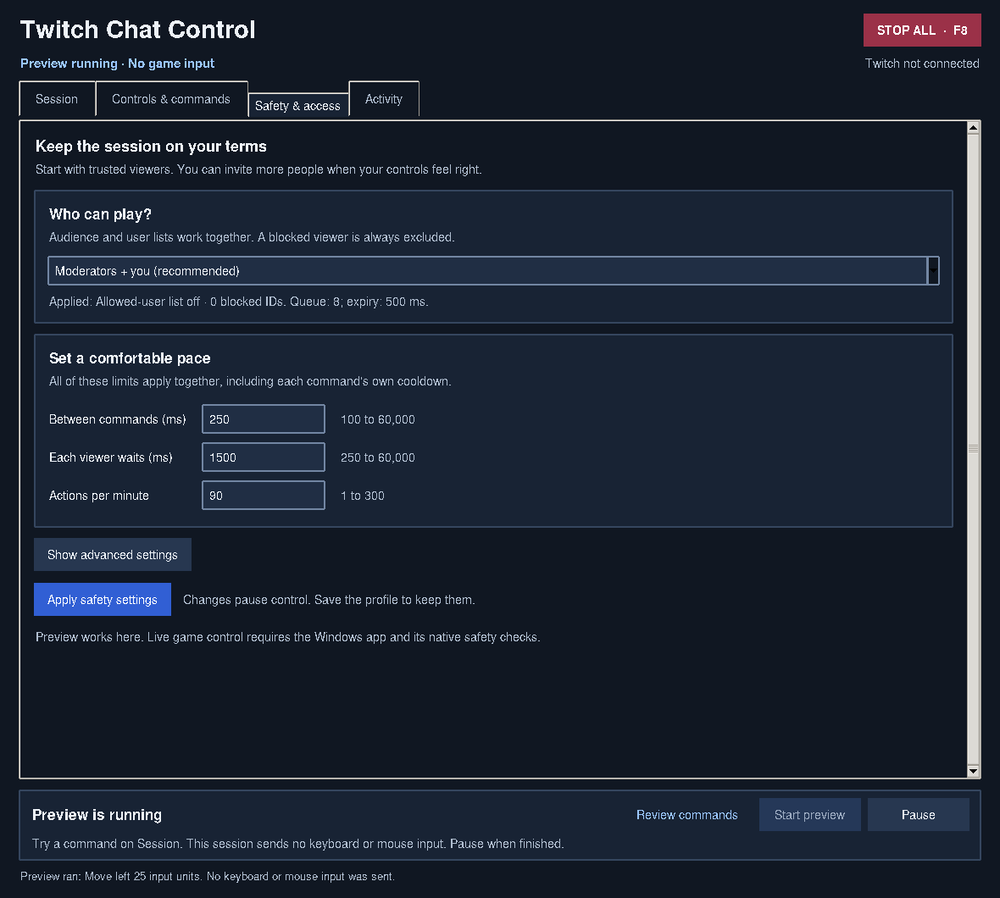
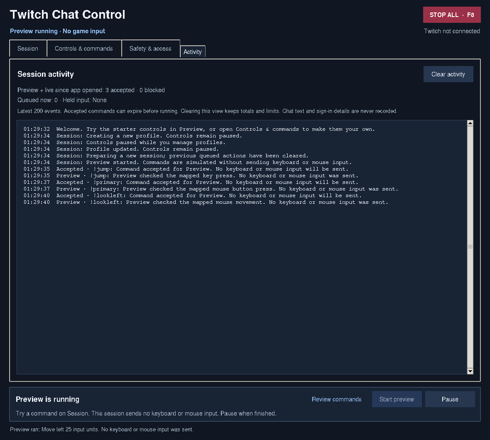

# Twitch Chat Control

Let your Twitch chat play your game, on your terms. Twitch Chat Control is a Windows desktop app that maps **exact chat commands** (like `!jump` or `!lookleft`) to **bounded keyboard and mouse actions**, with local arming, an emergency stop, and a Preview mode that never touches your real input.

> **Development preview.** Starts disarmed. Preview mode sends no input. Live control requires an explicitly selected game window, a working local emergency hotkey (F8), and a separate local arming action. Do not run as administrator.



## Features

- **Safe by default.** Starts paused in Preview. Live control needs a selected game window, a working F8 stop hotkey, and a deliberate local "Arm" click each session.
- **Exact commands only.** Chat can't add commands, change settings, type text, press combinations, or run anything. Only the commands you configure are accepted.
- **Keyboard and mouse actions.** Allowlisted keys, mouse buttons, relative mouse movement and vertical wheel scrolling, all with short, bounded holds and an independent release watchdog.
- **Point-and-click setup.** Ready-made starter profiles (WASD, arrow keys, keyboard and mouse) and a visual command editor. No JSON editing.
- **Practice pad.** Try any command offline and see what it would do. No Twitch account or game needed.
- **You decide who plays.** Moderators-only by default, with audience roles, allow/block lists, per-viewer, per-command and per-minute limits.
- **Your own Twitch app, no secrets.** You supply your own Public Client ID and sign in with device authorization. No client secret, and tokens stay in memory.
- **Private by design.** No telemetry, no network listener, no auto-update, and no credentials in profiles or builds.

## Screenshots

Captured from the real app running in Preview mode (offline, no Twitch connection, no input sent).

| Session and Practice pad | Controls and commands |
| --- | --- |
|  |  |
| **Safety and access** | **Activity** |
|  |  |

*Screenshots were captured on Linux, so fonts differ slightly from the Windows app.*

## Install (Windows)

Requirements: Windows 10/11 (64-bit) and 64-bit Python 3.11–3.14 with Tcl/Tk (the default python.org installer includes it).

A signed installer is not available yet. Until a release is published, run from source:

```powershell
py -3.12 -m venv .venv
.\.venv\Scripts\python.exe -m pip install -e .
.\.venv\Scripts\python.exe -m twitch_chat_control
```

Linux and macOS support the offline preview and automated tests; native game input is Windows only.

## Configuration

There are no environment variables or `.env` files. The app deliberately does not load them. Everything is configured in the app:

- **Twitch:** paste your own *Public* Client ID on the **Session** tab and sign in with device authorization. See [Twitch setup](docs/TWITCH_SETUP.md). Never paste a client secret anywhere.
- **Commands and safety limits:** edit in the app and use **Save profile** to write a profile JSON file. Profiles never contain credentials, selected windows, or armed state.

## First session

1. Start on **Session** with **Preview · no game input** selected. Click **Start preview** in the bottom bar, choose `!jump` under **Try a chat command**, and click **Try command**. The **Practice pad** shows the action when Preview runs it. No Twitch account or game is needed; Preview never moves the real pointer, clicks, scrolls, or presses keys.
2. Use **Edit commands** to make the starter controls your own. In **Controls & commands**, choose a **Blank**, **WASD movement**, **Arrow-key movement**, or **Keyboard & mouse** starting profile, or edit the current mappings. **Start with an action** and **Add command** prepare a mapping for you to review. Click **Apply command**, then **Save profile**.
3. Use **Who can play?** to review **Safety & access**. The default is **Moderators + you (recommended)**. Start with trusted participants and a comfortable command pace.
4. When ready, select **Live game control · Windows** on **Session**. Twitch and game setup appear. Supply your own Public Client ID and channel, then select **Connect Twitch**. See [Twitch setup](docs/TWITCH_SETUP.md); no client secret is needed. Keep the temporary sign-in code off your stream.
5. Open a game as a regular user, choose **Refresh windows**, and select its exact window. Read and check **I understand when to pause**. Click **Arm game control · 3 s** in the bottom bar, then focus the game before the countdown ends. For mouse commands, place the pointer over the game's playable area, away from window borders, menus, and overlays.
6. Use **Pause** or **F8** to stop. Losing game focus, disconnecting, or changing settings also stops control. Starting again always requires a local action.

The bottom bar stays visible on every tab. It explains what is ready or missing and offers a link to the next setup step. After a safety stop, it keeps the cause and recovery instructions visible; correcting the condition never automatically resumes control. **STOP ALL · F8** remains available at the top. To test actual chat without game input, stay in Preview and choose **Connect Twitch to test real chat...**.

## Safety boundaries

- Only exact configured commands are accepted. Chat cannot add commands, arm the app, change settings, run programs, access files, type arbitrary text, or provide key combinations.
- Commands are one action at a time: an allowlisted key, a bounded mouse-button press, relative mouse movement, or vertical wheel scrolling. Keys and buttons have short hold limits and an independent release watchdog. Enter, Tab, Escape, modifiers, function keys, the Windows key, key combinations, absolute pointer placement, and drag macros are unavailable to chat.
- Every action checks the foreground window and its bound process identity. Browsers, terminals, shell windows, elevated targets, and this app are rejected.
- Mouse actions also check the pointer against the selected game's client area and window under the pointer. Starting a mouse action while a physical mouse button is held is blocked. Movement near an edge can be refused; the app does not lock the streamer's pointer into the game.
- Per-viewer, per-command, global, and per-minute limits constrain floods. Queues and identity caches are bounded; stale and duplicate events are dropped.
- Streamers control audience roles and optional Twitch user-ID allow/block lists. Verified Twitch metadata supplies roles, not chat text or display names. Shared-chat events from another channel are ignored.
- No credentials ship in source or builds. No token files, environment-file loading, account database, network listener, telemetry, or automatic update system.

**Windows input is not a sandbox.** `SendInput` targets the current desktop input stream. There is a small foreground-switch race, and this app cannot distinguish gameplay from a text box or console inside the game. Pause before opening chat, console, overlays, purchases, or sensitive menus. A deliberate viewer can still take harmful actions *within the allowed game controls*. Use a disposable game/save for initial testing. Some games and anti-cheat systems reject synthetic input; this app does not bypass them. Read the full [security model](docs/SECURITY.md).

## Profiles and everyday controls

Configure mappings in **Controls & commands**; no JSON editing is required. **New command**, **Duplicate**, **Remove**, and **Enable this command** manage the list. Choose an action type, then set the fields for that action:

| Action | Configurable binding |
| --- | --- |
| Keyboard key | One letter, digit, arrow, or Space; hold 10–450 ms |
| Mouse button | Left, right, middle, or either side button; hold 10–450 ms |
| Mouse movement | Relative horizontal and vertical movement from −100 to 100 input units per axis; at least one axis must move |
| Mouse wheel | Scroll up or down by 1–3 wheel steps |

Each command has its own cooldown and shares the session's audience, viewer, global, and per-minute limits. For example, bind `!fire` to a short left-button press, `!lookleft` to a small leftward movement, and `!next` to one wheel step. Choose bindings that match the game. Windows pointer speed, acceleration, and game sensitivity affect movement; an input unit is not a guaranteed pixel or camera angle.

Use **Start with an action** for a ready-to-edit jump, forward movement, look direction, left/right mouse button, or wheel command. **Add command** creates an unapplied draft with an available trigger; review it before applying. The **Keyboard & mouse** profile supplies 13 commands with the same conservative access and pace settings as the other templates.

Keyboard bindings also offer **Press a key** while the app has focus. Capture accepts only an unmodified allowed key; **Cancel** or Escape ends capture and F8 stops control. Mouse bindings use explicit selectors and numeric fields, so configuring them does not capture or send mouse input.

**Apply command** updates the current profile in memory. **Save profile** writes it to disk; **Save a copy...** chooses another file and **Open profile...** loads one. The app keeps applied changes separate from unsaved drafts and prompts before replacing or closing an edited profile. Invalid fields remain available for correction. Existing keyboard profiles still load; adding a mouse binding upgrades that profile to schema 2, which requires v0.4.0 or later. Credentials, authorization, selected windows, and armed state are never saved.

The **Practice pad** illustrates keys, button presses, wheel direction, and relative movement. **Reset pad** recenters its virtual pointer and clears the illustration while preserving session cooldowns and limits. The pad does not calibrate a game's sensitivity or prove that the game accepts a binding. Commands are shown after Preview runs them; queued commands that expire are not displayed as completed actions.

On **Session**, **Copy chat commands** creates a plain-text reference for stream notes or a channel panel. It validates and applies pending edits first, then copies only enabled mappings, audience rules, and command pacing. The reference omits the profile name, Twitch user IDs, credentials, and runtime session details. An invalid draft leaves the clipboard unchanged. Copying does not save the profile or post anything to Twitch.

Use **Ctrl+S** to save, **Ctrl+Shift+S** to save a copy, **Ctrl+O** to open, and **Ctrl+1–4** or **Ctrl+Tab** to change tabs. Keyboard focus scrolls fields into view. No shortcut arms game input. Scrolling over a setting moves the page without accidentally changing its value; the command list and Activity scroll independently.

**Session** and **Activity** show **Preview + live since app opened** totals for accepted and blocked commands. Accepted means admitted to the queue; an accepted command can still expire before running. Ordinary chat and unconfigured commands are ignored and do not increase these totals. **Queued now** and **Held input** describe the current queue and held action. **Activity** shows the latest 200 approved events in plain language. **Clear activity** clears that view without resetting totals or policy limits. New events do not pull you back to the bottom while you read older entries. Status updates and command-list refreshes avoid repainting unchanged content.

The editor and imported JSON use the same strict validation. See the [GUI profile guide](docs/PROFILES.md) for templates, keyboard navigation, preview behavior, and field limits.

## Development and Windows build

```powershell
.\.venv\Scripts\python.exe -m pip install -e '.[dev,build]'
.\.venv\Scripts\python.exe -m pytest
.\.venv\Scripts\python.exe -m ruff check .
.\.venv\Scripts\python.exe scripts/check_distribution.py
.\.venv\Scripts\python.exe -m PyInstaller packaging/TwitchChatControl.spec --noconfirm --clean
```

The Windows CI workflow runs tests, performs a GUI construction smoke check, scans the distribution, and uploads a portable ZIP artifact. It builds from an explicit entry point and explicit public documentation; local profiles and credential files are never bundled. No signing certificate is bundled. Build artifacts are unsigned development builds until a separately managed signing/release process exists.

See [validation and manual acceptance](docs/VALIDATION.md) before streaming with live input.

## Contributing

Issues and pull requests are welcome. Please run the tests, `ruff`, and `scripts/check_distribution.py` (see above) before opening a PR. Never include credentials, tokens, or personal profile files in an issue or PR. Report suspected security problems privately through the repository's **Security** tab (private vulnerability reporting) instead of a public issue. Read the [security model](docs/SECURITY.md) first.

## License

[MIT](LICENSE)
